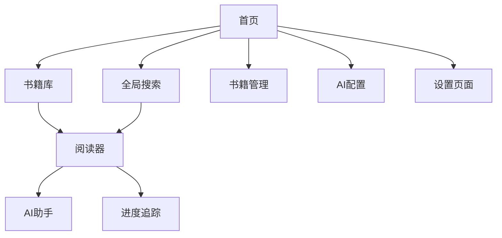

## 1. 产品概述

Juejin Flow 是一个智能沉浸式学习平台，将本地存储的大量散乱 Markdown 格式掘金小册转化为拥有极简阅读体验、进度追踪以及 AI 实时辅导功能的 Web 私人图书馆。

核心价值：
- **结构化**：自动扫描文件系统，将散乱的 MD 文件构建成树形书籍结构
- **沉浸式**：提供优于 VS Code 或普通 MD 阅读器的排版和 UI 体验
- **智能化**：通过 RAG 技术，让 AI 基于当前阅读内容提供答疑和总结
- **护眼体验**：专为长时间阅读设计的护眼主题和字体优化

## 2. 核心功能

### 2.1 用户角色
| 角色 | 注册方式 | 核心权限 |
|------|----------|----------|
| 本地用户 | 无需注册，本地使用 | 完整访问所有功能，数据本地存储 |

### 2.2 功能模块

我们的智能学习平台包含以下主要页面：

1. **首页**: 书籍库展示、全局搜索、阅读统计、护眼主题切换
2. **阅读器**: 三栏式布局（导航栏、内容区、AI助手）、进度追踪、护眼模式
3. **书籍管理**: 文件扫描、元数据编辑、封面图片管理
4. **AI配置**: 模型选择、API密钥管理、RAG参数调整
5. **设置页面**: 主题设置、阅读偏好、数据备份

### 2.3 页面详情

| 页面名称 | 模块名称 | 功能描述 |
|----------|----------|----------|
| 首页 | 书籍库展示 | 以卡片形式展示所有书籍，显示阅读进度、最近阅读时间 |
| 首页 | 全局搜索 | 支持按书名、章节、内容全文搜索，实时显示搜索结果 |
| 首页 | 阅读统计 | 显示总阅读时间、完成章节数、学习天数等统计数据 |
| 首页 | 护眼主题切换 | 一键切换护眼模式，调整色温和亮度 |
| 阅读器 | 左侧导航栏 | 树形结构展示书籍章节，支持折叠展开，显示阅读状态 |
| 阅读器 | 中间内容区 | Markdown渲染、代码高亮、图片展示、划词功能 |
| 阅读器 | 右侧AI助手 | 可折叠的AI对话面板，支持上下文问答、内容总结 |
| 阅读器 | 进度追踪 | 自动保存阅读位置，显示当前章节进度百分比 |
| 阅读器 | 护眼模式 | 专为长时间阅读优化的配色方案，支持深色模式 |
| 书籍管理 | 文件扫描 | 自动扫描指定文件夹，识别Markdown文件结构 |
| 书籍管理 | 元数据编辑 | 编辑书籍标题、描述、标签等信息 |
| 书籍管理 | 封面图片管理 | 支持本地图片作为书籍封面，自动优化显示 |
| AI配置 | 模型选择 | 支持OpenAI、Ollama等多种AI模型 |
| AI配置 | API密钥管理 | 安全存储和管理AI服务的API密钥 |
| AI配置 | RAG参数调整 | 配置向量搜索参数、上下文窗口大小等 |
| 设置页面 | 主题设置 | 选择护眼主题、字体大小、行间距等 |
| 设置页面 | 阅读偏好 | 设置自动保存间隔、滚动行为等 |
| 设置页面 | 数据备份 | 支持导出和导入学习数据 |

## 3. 核心流程

### 用户主要操作流程：

1. **首次使用流程**：
   - 用户启动应用 → 设置书籍文件夹路径 → 系统自动扫描 → 生成书籍库 → 开始阅读

2. **日常阅读流程**：
   - 浏览书籍库 → 选择书籍 → 进入阅读器 → 阅读内容 → 使用AI助手 → 记录进度

3. **内容搜索流程**：
   - 在首页搜索框输入关键词 → 系统全文搜索 → 显示搜索结果 → 点击跳转到具体章节

## 4. 用户界面设计

### 4.1 设计风格

- **护眼主题**：
  - 主色：#F5F5DC（米色背景）
  - 辅色：#2E7D32（深绿色文字）
  - 强调色：#FF6B35（橙色高亮）
  - 深色模式：#1E1E1E（背景）/#E0E0E0（文字）

- **字体设计**：
  - 标题：Source Han Sans，Semi-bold，24px
  - 正文：Inter 或 Source Han Sans，Regular，17px
  - 代码：Fira Code，14px

- **布局风格**：
  - 卡片式布局，圆角设计
  - 左侧固定导航，中间自适应内容
  - 柔和阴影和过渡动画

### 4.2 页面设计概览

| 页面名称 | 模块名称 | UI元素 |
|----------|----------|--------|
| 首页 | 书籍库 | 卡片网格布局，每本书显示封面、标题、进度条，悬停效果 |
| 首页 | 搜索框 | 顶部居中，圆角设计，实时搜索建议下拉列表 |
| 阅读器 | 内容区 | 最大宽度3xl，行高1.8，段落间距大，适合长时间阅读 |
| 阅读器 | 护眼模式 | 一键切换按钮，平滑过渡动画，色温调节滑块 |
| AI助手 | 对话面板 | 可拖拽调整宽度，消息气泡设计，支持代码块渲染 |

### 4.3 响应式设计

- **桌面优先**：主要面向桌面端用户，优化大屏幕阅读体验
- **移动端适配**：支持平板和手机基本浏览功能
- **触控优化**：按钮大小适合触控操作

### 4.4 护眼设计专项

- **色温调节**：支持暖色温调节，减少蓝光
- **亮度自适应**：根据时间自动调整亮度
- **字体优化**：使用易读性高的字体，优化字间距
- **背景纹理**：轻微纸张纹理，减少眼睛疲劳
- **阅读提醒**：定时提醒休息，保护视力健康