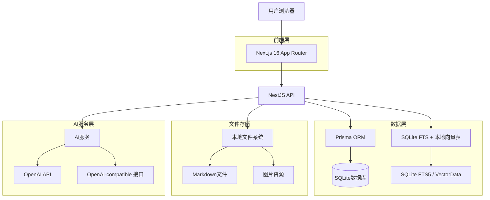
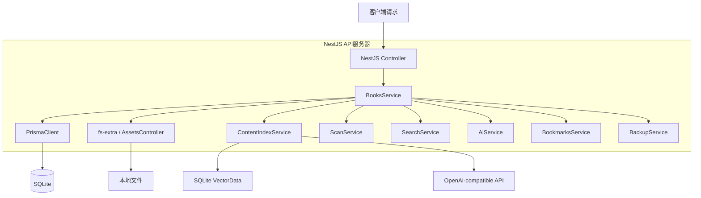
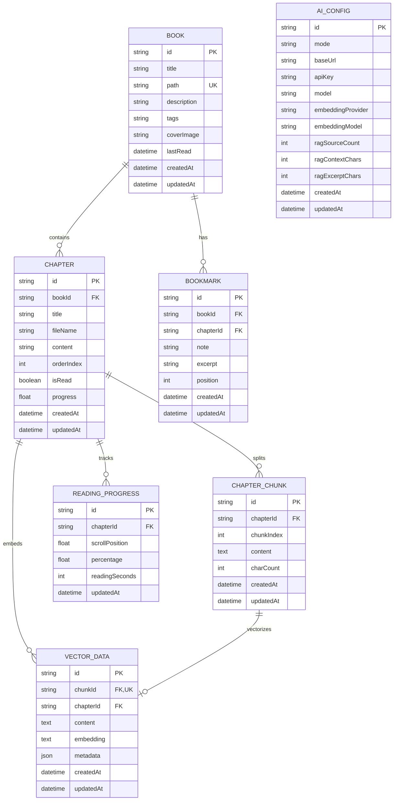

## 1. 架构设计



## 2. 技术栈描述

* **前端**: Next.js 16 (App Router) + React 19 + TypeScript

* **样式**: Tailwind CSS 4 + Lucide React图标

* **后端**: NestJS 11 + TypeScript

* **数据库**: SQLite + Prisma ORM

* **全文检索**: SQLite FTS5

* **语义检索**: 本地 hash embedding 或 OpenAI-compatible `/embeddings` + SQLite `VectorData` 表

* **Markdown处理**: gray-matter + react-markdown

* **代码高亮**: 前端轻量 tokenizer

* **AI集成**: 本地抽取式回答 + OpenAI-compatible `/chat/completions`

* **动画**: framer-motion

桌面端使用独立的 Electron 原生运行链路：主进程加载 `packages/desktop/dist/renderer` 中的静态 React 页面，preload 只暴露动态 API 地址以及文件对话框和确认对话框等 Electron 原生能力。主进程应用 Prisma migration 后，以 `ELECTRON_RUN_AS_NODE=1` 的子进程启动 Nest HTTP 服务，服务只绑定 `127.0.0.1` 的动态端口；renderer 通过 `/api` Controller 调用书库、扫描、搜索、AI、备份、书签和资源接口，AI 流式问答使用 SSE。Web 与移动端继续通过同一套 Nest HTTP API 访问业务服务。

## 3. 路由定义

| 路由                             | 用途             |
| ------------------------------ | -------------- |
| `/`                            | 首页，显示书籍库和阅读统计  |
| `/book/[bookId]`               | 书籍章节列表        |
| `/book/[bookId]/[chapterId]`   | 阅读器页面，三栏式布局    |
| `/search`                      | 全局搜索页面         |
| `/management`                  | 书籍管理页面         |
| `/settings`                    | 设置页面，包含主题和AI配置 |
| `/api/books`                   | 书籍数据API        |
| `/api/books/:bookId/chapters/:chapterId` | 章节数据API |
| `/api/search`                  | 搜索API          |
| `/api/ai/chat`                 | AI对话API        |
| `/api/ai/chat/stream`          | AI 流式对话 API    |
| `/api/ai/config`               | AI 与 RAG 参数配置 API |
| `/api/books/stats`             | 阅读统计API        |
| `/api/scan/jobs`               | 启动带进度的扫描任务 |
| `/api/scan/rescan-known/jobs`  | 启动已知书籍重扫任务 |
| `/api/scan/jobs/:id`           | 查询扫描任务状态     |
| `/api/scan/jobs/:id/cancel`    | 取消扫描任务         |

## 4. API定义

### 4.1 书籍管理API

**获取书籍列表**

```
GET /api/books
```

响应为书籍数组，每项包含 `chapters`、`totalChapters`、`readChapters`、`tags` 等字段。

**扫描文件夹**

```
POST /api/scan
```

请求：

```json
{
  "path": "string"
}
```

**后台扫描任务**

```
POST /api/scan/jobs
POST /api/scan/rescan-known/jobs
GET /api/scan/jobs/:id
POST /api/scan/jobs/:id/cancel
```

任务状态包含 `queued`、`scanning`、`indexing`、`cancelled`、`completed`、`failed`。服务会把最近任务状态写入本地 JSON 文件，重启时未完成任务会标记为中断。

### 4.2 阅读进度API

**更新阅读进度**

```
PUT /api/books/:bookId/chapters/:chapterId/progress
```

请求：

```json
{
  "progress": "number",
  "scrollPosition": "number",
  "readingSecondsDelta": "number"
}
```

### 4.3 AI对话API

**发送消息**

```
POST /api/ai/chat
```

请求：

```json
{
  "message": "string",
  "context": {
    "bookId": "string",
    "chapterId": "string",
    "selectedText": "string"
  },
  "config": {
    "mode": "local|openai-compatible",
    "baseUrl": "string",
    "model": "string",
    "apiKey": "string",
    "ragSourceCount": "number",
    "ragContextChars": "number",
    "ragExcerptChars": "number"
  }
}
```

响应：

```json
{
  "answer": "string",
  "mode": "local-extractive|openai-compatible",
  "sources": [
    {
      "id": "string",
      "bookId": "string",
      "chapterId": "string",
      "bookTitle": "string",
      "chapterTitle": "string",
      "excerpt": "string",
      "relevance": 100
    }
  ]
}
```

**读取/保存 AI 与 RAG 配置**

```
GET /api/ai/config
PUT /api/ai/config
```

配置项包括模型模式、OpenAI-compatible 连接信息、API Key、embedding provider/model，以及 RAG 的引用数量、上下文字数、摘录长度。API Key 在数据库中加密保存，备份导出时脱敏。Embedding 默认使用本地 hash 向量；选择 OpenAI-compatible 且配置 key 后会调用 `/embeddings`，向量配置变化时自动重建 SQLite `VectorData` 索引。

### 4.4 搜索API

**全文搜索**

```
GET /api/search?q=string&bookId=string
```

响应：

```json
[
  {
    "id": "string",
    "type": "book|chapter|content",
    "title": "string",
    "content": "string",
    "highlightedContent": "string",
    "score": 100,
    "bookId": "string",
    "chapterId": "string",
    "bookTitle": "string"
  }
]
```

## 5. 服务器架构



## 6. 数据模型

### 6.1 数据模型定义



### 6.2 数据定义来源

数据库结构以 `packages/server/prisma/schema.prisma` 和
`packages/server/prisma/migrations/` 为唯一事实来源。章节正文同时保存在
`Chapter.content` 与 `ChapterChunk.content` 中：前者用于阅读和备份，后者用于
FTS/RAG。`ChapterChunkFts` 是迁移创建的 SQLite FTS5 虚表，不属于 Prisma
关系模型，因此由 `ContentIndexService` 显式重建和清理。

## 7. RAG实现方案

### 7.1 文本索引流程

1. **文件扫描时**：将每个章节内容分割成适当大小的文本块
2. **全文索引**：将标题和正文写入 SQLite FTS5 虚拟表
3. **本地向量化**：使用确定性的 hash embedding 生成轻量向量
4. **存储向量**：将序列化 embedding 与原始 chunk 写入 `VectorData`

### 7.2 向量搜索流程

1. **用户查询**：接收用户的问题或选中的文本
2. **混合检索**：优先使用 FTS5，补充本地向量余弦相似度
3. **上下文构建**：将相关片段组合成 AI 的上下文
4. **生成回答**：本地模式返回抽取式回答；OpenAI-compatible 模式调用 `/chat/completions`

### 7.3 图片处理策略

* **本地图片服务**：由 NestJS 资源接口代理书籍目录内的图片文件

* **路径映射**：将Markdown中的相对路径映射到可访问的URL

* **缓存策略**：资源接口返回私有 HTTP 缓存头；本地 Markdown 图片在 Web 阅读器中不经过 Next 图片转换

* **格式支持**：支持常见的图片格式（PNG, JPG, GIF, SVG）
