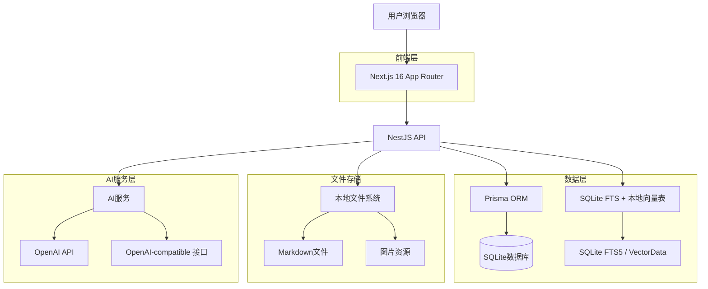
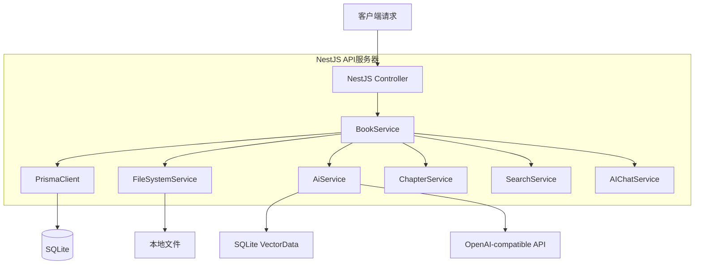
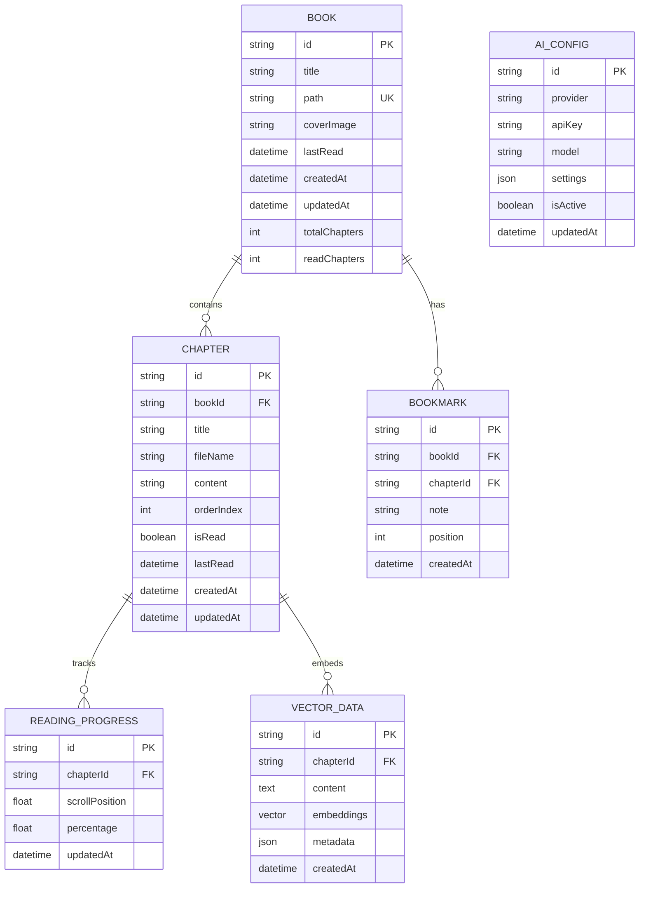

## 1. 架构设计



## 2. 技术栈描述

* **前端**: Next.js 16 (App Router) + React 19 + TypeScript

* **样式**: Tailwind CSS 4 + Lucide React图标

* **后端**: NestJS 11 + TypeScript

* **数据库**: SQLite + Prisma ORM

* **全文检索**: SQLite FTS5

* **语义检索**: 本地 hash embedding + SQLite `VectorData` 表

* **Markdown处理**: gray-matter + react-markdown

* **代码高亮**: 前端轻量 tokenizer

* **AI集成**: 本地抽取式回答 + OpenAI-compatible `/chat/completions`

* **动画**: framer-motion

## 3. 路由定义

| 路由                             | 用途             |
| ------------------------------ | -------------- |
| `/`                            | 首页，显示书籍库和阅读统计  |
| `/book/[bookId]/[chapterId]`   | 阅读器页面，三栏式布局    |
| `/search`                      | 全局搜索页面         |
| `/management`                  | 书籍管理页面         |
| `/settings`                    | 设置页面，包含主题和AI配置 |
| `/api/books`                   | 书籍数据API        |
| `/api/books/:bookId/chapters/:chapterId` | 章节数据API |
| `/api/search`                  | 搜索API          |
| `/api/ai/chat`                 | AI对话API        |
| `/api/books/stats`             | 阅读统计API        |

## 4. API定义

### 4.1 书籍管理API

**获取书籍列表**

```
GET /api/books
```

响应：

```json
{
  "books": [
    {
      "id": "string",
      "title": "string",
      "path": "string",
      "coverImage": "string",
      "lastRead": "datetime",
      "progress": "number",
      "totalChapters": "number",
      "readChapters": "number"
    }
  ]
}
```

**扫描文件夹**

```
POST /api/books/scan
```

请求：

```json
{
  "folderPath": "string"
}
```

### 4.2 阅读进度API

**更新阅读进度**

```
POST /api/chapters/progress
```

请求：

```json
{
  "chapterId": "string",
  "progress": "number",
  "isRead": "boolean"
}
```

### 4.3 AI对话API

**发送消息**

```
POST /api/ai/chat
```

请求：

```json
{
  "message": "string",
  "context": {
    "bookId": "string",
    "chapterId": "string",
    "selectedText": "string"
  },
  "model": "string"
}
```

响应：

```json
{
  "response": "string",
  "sources": [
    {
      "chapterId": "string",
      "relevance": "number"
    }
  ]
}
```

### 4.4 搜索API

**全文搜索**

```
GET /api/search?q=string&bookId=string
```

响应：

```json
{
  "results": [
    {
      "id": "string",
      "type": "chapter|content",
      "title": "string",
      "content": "string",
      "score": "number",
      "bookId": "string",
      "chapterId": "string"
    }
  ]
}
```

## 5. 服务器架构



## 6. 数据模型

### 6.1 数据模型定义



### 6.2 数据定义语言

**书籍表 (books)**

```sql
-- 创建表
CREATE TABLE books (
    id TEXT PRIMARY KEY,
    title TEXT NOT NULL,
    path TEXT UNIQUE NOT NULL,
    coverImage TEXT,
    lastRead DATETIME,
    createdAt DATETIME DEFAULT CURRENT_TIMESTAMP,
    updatedAt DATETIME DEFAULT CURRENT_TIMESTAMP,
    totalChapters INTEGER DEFAULT 0,
    readChapters INTEGER DEFAULT 0
);

-- 创建索引
CREATE INDEX idx_books_lastRead ON books(lastRead DESC);
CREATE INDEX idx_books_path ON books(path);
```

**章节表 (chapters)**

```sql
-- 创建表
CREATE TABLE chapters (
    id TEXT PRIMARY KEY,
    bookId TEXT NOT NULL,
    title TEXT NOT NULL,
    fileName TEXT NOT NULL,
    content TEXT,
    orderIndex INTEGER,
    isRead BOOLEAN DEFAULT FALSE,
    lastRead DATETIME,
    createdAt DATETIME DEFAULT CURRENT_TIMESTAMP,
    updatedAt DATETIME DEFAULT CURRENT_TIMESTAMP,
    FOREIGN KEY (bookId) REFERENCES books(id) ON DELETE CASCADE
);

-- 创建索引
CREATE INDEX idx_chapters_bookId ON chapters(bookId);
CREATE INDEX idx_chapters_order ON chapters(bookId, orderIndex);
```

**阅读进度表 (readingProgress)**

```sql
-- 创建表
CREATE TABLE readingProgress (
    id TEXT PRIMARY KEY,
    chapterId TEXT UNIQUE NOT NULL,
    scrollPosition REAL DEFAULT 0,
    percentage REAL DEFAULT 0,
    updatedAt DATETIME DEFAULT CURRENT_TIMESTAMP,
    FOREIGN KEY (chapterId) REFERENCES chapters(id) ON DELETE CASCADE
);
```

**向量数据表 (VectorData)**

```sql
-- 当前实现：SQLite 中保存序列化后的本地 embedding
CREATE TABLE vectorData (
    id TEXT PRIMARY KEY,
    chapterId TEXT NOT NULL,
    content TEXT NOT NULL,
    metadata TEXT,
    createdAt DATETIME DEFAULT CURRENT_TIMESTAMP,
    FOREIGN KEY (chapterId) REFERENCES chapters(id) ON DELETE CASCADE
);

-- 创建索引
CREATE INDEX idx_vectorData_chapterId ON vectorData(chapterId);
```

## 7. RAG实现方案

### 7.1 文本索引流程

1. **文件扫描时**：将每个章节内容分割成适当大小的文本块
2. **全文索引**：将标题和正文写入 SQLite FTS5 虚拟表
3. **本地向量化**：使用确定性的 hash embedding 生成轻量向量
4. **存储向量**：将序列化 embedding 与原始 chunk 写入 `VectorData`

### 7.2 向量搜索流程

1. **用户查询**：接收用户的问题或选中的文本
2. **混合检索**：优先使用 FTS5，补充本地向量余弦相似度
3. **上下文构建**：将相关片段组合成 AI 的上下文
4. **生成回答**：本地模式返回抽取式回答；OpenAI-compatible 模式调用 `/chat/completions`

### 7.3 图片处理策略

* **本地图片服务**：使用Next.js的Image组件优化本地图片加载

* **路径映射**：将Markdown中的相对路径映射到可访问的URL

* **缓存策略**：实现图片缓存，提高加载性能

* **格式支持**：支持常见的图片格式（PNG, JPG, GIF, SVG）
